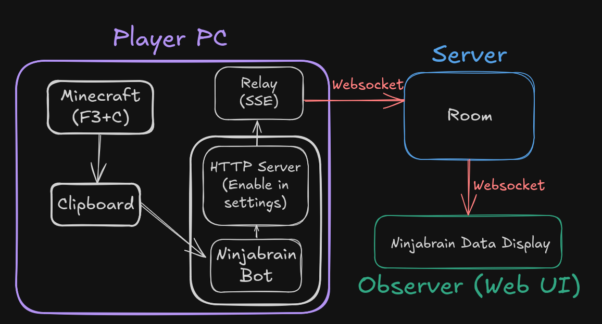

# Ninjabrain Party

Ninjabrain Party is an observation tool for [Ninjabrain Bot](https://github.com/Ninjabrain1/NinjabrainBot). It allows Minecraft speedrunners to broadcast their stronghold triangulation data to observers in real-time (ish) through a web dashboard.

## Installation

1. Player downloads the relay binary from the [releases](https://github.com/Ninjabrain1/NinjabrainParty/releases) page and runs it. See [Windows Defender Warning](#windows-defender-warning) for an explanation for Windows Defender stuff.
2. Once ran, it opens a local web page containing the room code or the observation room direct link.
3. Player gives the observer the room code or the observation room direct link.
4. Observer goes to the observation site and enters the code, or joins the room directly with the link.
5. Go!

## Architecture



The system is split into four main components to ensure make it as simple as possible to setup:

1.  **Ninjabrain Bot (Existing)**: The source of truth, running on the player's local machine with its HTTP API enabled (in Settings -> Advanced -> Enable API).
2.  **Relay (`/relay`)**: A simple Go executable that runs on the player's PC. It reads the local SSE stream from Ninjabrain Bot and forwards the data to the central server via WebSockets.
3.  **Central Server (`/server`)**: A Go application acting as a headless message broker. It manages "Rooms" in-memory and routes data from runners to their observers who have joined the room.
4.  **Observer (`/observer`)**: A modern SvelteKit web dashboard where observers can view live data (eye throws, triangulation results, and player position) by just entering a room code.

## Privacy

-   **No Personal Data**: The central server does not collect or store any personal data from observers nor runners.
-   **No Data Retention**: The central server does not store any data after it has been relayed to observers. The Ninjabrain data is stored in memory, once the room closes, it is gone.

## Why a Relay?

A key choice was using a central relay server instead of direct peer-to-peer (P2P) connections between the player and the observer.

-   **Privacy & Security**: By routing data through a central server, the player's IP address is never exposed to observers. Random people joining a room (code leak, or somehow guessed) only see the data, not the player's network location.
-   **Reliability**: Direct connections can fail due to ISP restrictions, NAT traversal issues, or complex router configurations. Using a WebSocket-based relay bypasses these hurdles entirely, requiring zero port-forwarding from the player.
-   **Performance**: The Go-based relay and server provide pretty low latency due to the websocket setup.

## Tech Stack

-   **Backend**: Go (standard library + `chi` for routing, `coder/websocket` for fast communication).
-   **Frontend**: Svelte 5 & SvelteKit. Standard websockets for communication with the server.
-   **Infrastructure**: Dockerized server deployment. Observer (Web UI) is hosted on Cloudflare.

## Repository Structure

```text
├─ relay/      # Player-side local Go relay
├─ server/     # Central Go WebSocket broker
├─ observer/   # SvelteKit web dashboard for observers
├─ shared/     # Shared JSON schemas and types
├─ infra/      # Docker & deployment configurations
└─ Makefile    # Development and build commands
```

## Windows Defender Warning

### Important: Unsigned Executable

The relay binary (`Ninjabrain-Relay.exe`) is an unsigned executable. When you first run it on Windows, you will likely encounter one of these warnings:

1. Windows SmartScreen - "Windows protected your PC"
2. Windows Defender - Potential false positive detection

### How to Bypass SmartScreen

1. Click **"More info"**
2. Click **"Run anyway"**

### How to Whitelist in Windows Defender

If Windows Defender blocks the executable:

1. Open **Windows Security** → **Virus & threat protection**
2. Click **"Manage settings"** under Virus & threat protection settings
3. Scroll to **Exclusions** and click **"Add or remove exclusions"**
4. Click **"Add an exclusion"** → **"File"**
5. Select the `Ninjabrain-Relay.exe` file

### Why This Happens

- The executable is not code-signed with a Microsoft-trusted certificate
- It opens network ports (WebSocket connection)
- Go binaries sometimes trigger heuristics due to their static linking

## Getting Started / Development

Check out the [LOCAL_DEV.md](docs/LOCAL_DEV.md) for instructions on setting up the project locally.

## Credits

This project is entirely dependent upon the fantastic [Ninjabrain Bot](https://github.com/Ninjabrain1/NinjabrainBot) by [Ninjabrain1](https://github.com/Ninjabrain1/). 
Some magic numbers and constants are derived from that project, as well as some UI elements like the boat colors.

## License

See [LICENSE (GPLv3)](LICENSE).
